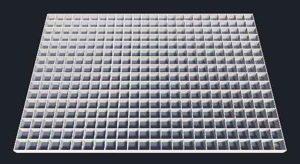

# MazePlace

Generate, explore and solve multi-level 3D mazes in Unity, and watch the algorithms work.



**[Play it in your browser](https://aarongodwood.github.io/MazePlace/)**

A rebuild of my A-Level Computer Science NEA. The original is kept untouched on the
[`nea-archive`](../../tree/nea-archive) branch (tag `nea-original`).

## Features

- **Generators:** recursive backtracker (DFS), randomised Kruskal's (union-find) and Wilson's
  (loop-erased random walks, which pick uniformly from every possible maze)
- **Solvers:** depth-first, breadth-first, greedy best-first and A*
- **Animated generation:** passages open in the order the generator carved them
- **Animated solving:** every cell the solver explored, then the path it found
- **Up to 40 × 40 × 8 cells**, with shafts between levels
- **Overview camera** (orbit, zoom, step through levels) and **first-person** mode
- Menus, options, and four save slots

## Controls

| | Overview | First person |
|---|---|---|
| Look | Right-drag to orbit, scroll to zoom | Mouse |
| Move | Q / E change level | WASD; hold Space under a shaft to climb |
| Solve / new maze | F / G | F / G |
| Switch view | Tab | Tab |
| Menu | Esc | Esc |

## How it's built

```
Assets/Scripts/Core/   pure C#, no UnityEngine: grid, maze, generators, solvers, save format
Assets/Scripts/Game/   thin MonoBehaviours: rendering, animation, input, UI, persistence
tests/                 xUnit tests for Core, run with plain dotnet (no Unity needed)
```

- A maze is one passage bit-flag per cell, so it costs a byte per cell rather than the
  O(n²) adjacency matrix the original used.
- Generators record the order they carve passages in, so any generator can be replayed without
  animation code inside the algorithm.
- DFS, BFS and greedy best-first share one search loop and differ only in their frontier
  (stack, queue, priority queue). A* tracks path costs separately, so it still finds the
  shortest path in mazes with loops.
- Each level is a single generated mesh with walls and floors as submeshes.

## Running it

- **Unity 6** (6000.6). A fresh clone opens with no extra packages or assets.
- Tests: `cd tests && dotnet test`
- Rebuild the scene and materials from code: **MazePlace → Rebuild Scene**
- Build for the browser: **MazePlace → Build WebGL**, or headless with
  `-executeMethod MazePlace.Editor.Build.WebGL`
